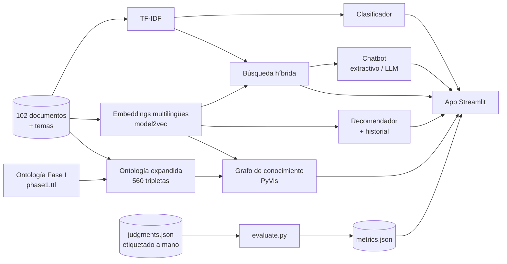

# ☁️ La Nube — Asistente de conocimiento

**Clasificación de documentos, búsqueda semántica, recomendaciones, chatbot y grafo de conocimiento para un mini-súper de barrio con carnicería.**

*Felix Yael · Universidad Tecmilenio · Gestión del Conocimiento, Fase 3 (prototipo final)*

**App en línea:** https://la-nube-gestion-conocimiento-oh27aiwzetkmeuk37gfncd.streamlit.app

---

## Cómo probarla (2 minutos)

1. En **💬 Preguntar**, toca un ejemplo o escribe una pregunta con tus palabras: *"olvidé mi PIN"*, *"quién nos debe dinero"*, *"me sobró dinero en el corte"*.
2. Revisa las **Fuentes**: cada dato dice de qué documento salió (por ejemplo **[D04]**).
3. Intenta que falle: pregunta algo que no sea de la tienda (*"receta de pastel"*, *"capital de Francia"*). Debe responder que no lo encontró en vez de inventar.
4. Opcional: busca documentos en **🔎 Buscar**, pega un texto en **🏷️ Clasificar** o revisa el mapa de conocimiento y las métricas en **⚙️ Cómo funciona**.

## La organización

**La Nube** es un mini-súper ficticio en México: 2 cajas, 1 carnicería con báscula de etiquetas y un servidor local que sigue vendiendo cuando se cae el internet. Su conocimiento vive en 102 documentos en español: manuales, reportes, ventas, inventario y políticas. Los procedimientos (teclas de la caja, corte, crédito, terminal, respaldos, PIN) siguen los manuales reales del punto de venta de la tienda; las cifras de ventas son ilustrativas y se omiten nombres, datos de red, costos y proveedores. Los cajeros nuevos hacen las mismas preguntas cada semana y el dueño pierde tiempo buscando reportes.

## Qué hace el sistema

| Pestaña | Función | Cómo |
|---|---|---|
| 💬 Preguntar | Responde con los documentos y cita la fuente; rechaza lo que no es de la tienda | Recupera los 3 documentos más cercanos y arma la respuesta con sus frases más relevantes; con `DEEPSEEK_API_KEY` la redacta un LLM (y si falla, vuelve a la versión extractiva) |
| 🔎 Buscar | Encuentra documentos por significado, no solo por palabras exactas | Puntaje híbrido: TF-IDF + embeddings multilingües model2vec (coseno) |
| ⭐ Te puede interesar | Recomendaciones en la barra lateral y "documentos parecidos" en cada documento | Similitud entre embeddings; perfil de sesión con las búsquedas y documentos recientes |
| 🏷️ Clasificar | Predice el tipo de un documento nuevo | TF-IDF + embeddings + regresión logística (el mejor de 4 modelos) |
| ⚙️ Cómo funciona | Mapa de conocimiento y métricas | Ontología OWL de la Fase I expandida a 560 tripletas (rdflib → NetworkX → PyVis); `outputs/metrics.json` |




## Resultados

Todas las cifras salen de `python evaluate.py` y de las respuestas correctas etiquetadas a mano en `data/judgments.json`.

**Clasificación** (validación cruzada estratificada de 5 particiones, 102 documentos, 5 tipos)

| Modelo | Exactitud | Precisión macro | Recall macro | F1 macro |
|---|:-:|:-:|:-:|:-:|
| Naive Bayes (TF-IDF) | 0.78 | 0.78 | 0.78 | 0.77 |
| LogReg (TF-IDF) | 0.80 | 0.80 | 0.81 | 0.80 |
| LogReg (embeddings) | 0.81 | 0.81 | 0.82 | 0.81 |
| **LogReg (TF-IDF + embeddings) — en la app** | **0.82** | **0.83** | **0.83** | **0.82** |

**Búsqueda** (26 consultas juzgadas: 13 con las palabras del documento, 13 dichas con otras palabras)

| Motor | Palabras exactas P@3 / R@5 / MRR | Otras palabras P@3 / R@5 / MRR |
|---|:-:|:-:|
| TF-IDF (Fase I) | 0.87 / 0.80 / 1.00 | 0.31 / 0.38 / 0.52 |
| Embeddings | 0.87 / 0.73 / 1.00 | 0.46 / 0.50 / 0.77 |
| **Híbrido — en la app** | **0.90 / 0.79 / 1.00** | **0.44 / 0.44 / 0.72** |

**Recomendaciones** (16 documentos semilla con relacionados etiquetados): embeddings P@5 0.49, nDCG@5 0.64, contra 0.06 de documentos al azar del mismo tipo. El historial de búsqueda sube P@5 en consultas ambiguas de 0.46 a 0.54.

**Chatbot** (18 preguntas con respuesta conocida): la fuente correcta aparece entre las 3 primeras en 18/18; la respuesta contiene el dato esperado en 17/18; rechaza 3/3 preguntas fuera de tema.

**Usabilidad:** SUS + 3 tareas con usuarios reales — ver `usability/`.

## Ejecutar en local

```bash
pip install -r requirements.txt
streamlit run app.py
python evaluate.py            # regenera outputs/metrics.json
python knowledge.py           # autoverificación
```

La primera vez se descarga el modelo de embeddings (`minishlab/potion-multilingual-128M`, ~500 MB; se carga en float16). Respuestas con LLM opcionales: crea `.streamlit/secrets.toml` con `DEEPSEEK_API_KEY = "..."` (ignorado por git) o configúralo en Streamlit Cloud → App settings → Secrets.

## Estructura

| Ruta | Contenido |
|---|---|
| `app.py` | App Streamlit (4 pestañas + recomendaciones en la barra lateral) |
| `knowledge.py` | Corpus, búsqueda, clasificador, recomendador, chatbot, ontología y grafo |
| `evaluate.py` | Evaluación → `outputs/metrics.json` |
| `data/documents.csv` | 102 documentos con tipo y temas |
| `data/judgments.json` | Consultas, documentos relacionados y preguntas etiquetadas a mano |
| `ontology/phase1.ttl` | Ontología OWL de la Fase I (se expande al ejecutar; descargable en ⚙️ Cómo funciona) |
| `usability/` | Guion de prueba, cuestionario SUS y calculadora |
| `presentation/speech.md` | Discurso de 10 minutos para la presentación ejecutiva |
| `phase1/` | Entregables de la Fase I (reporte, diagramas, salidas) |
