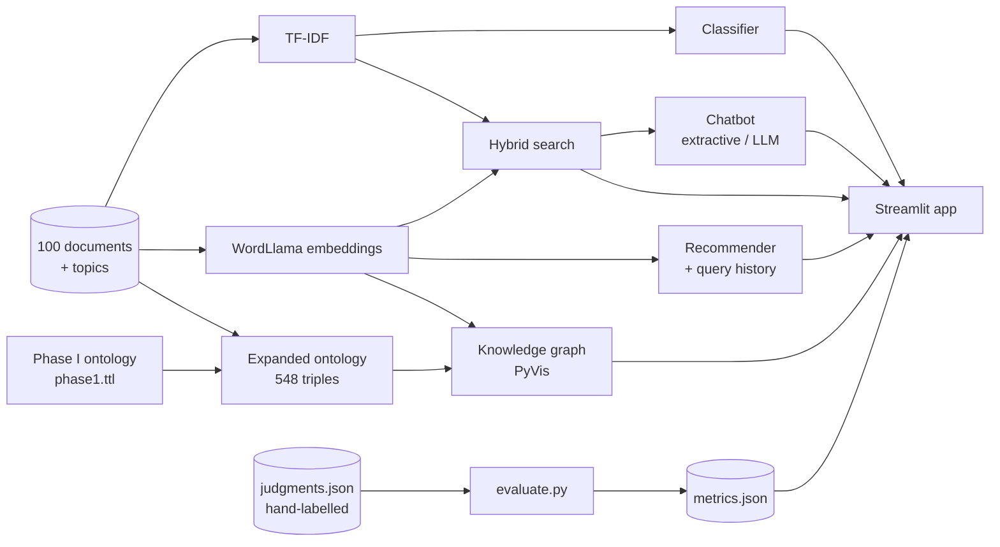

# ☁️ La Nube — Knowledge Assistant

**Document classification, semantic search, recommendations, a chatbot and a knowledge graph for a neighbourhood supermarket with a butcher counter.**

*Felix Yael · Universidad Tecmilenio · Knowledge Management project, Phase 3 (final prototype)*

**Live app:** _pending deployment on Streamlit Community Cloud_

---

## The organisation

**La Nube** is a fictional mini-supermarket in Mexico: 2 registers, 1 butcher counter with a label scale and a local server that keeps selling when the internet goes down. Its knowledge lives in 100 documents: manuals, reports, sales documents, inventory records and policies. New cashiers ask the same questions every week and the owner spends time looking for reports.

## What the system does

| Tab | Function | How |
|---|---|---|
| 🔎 Search | Find documents by meaning, not only exact words | Hybrid score: TF-IDF + WordLlama embeddings (cosine) |
| ⭐ Recommendations | "Related documents" for each doc + "Recommended for you" in the sidebar | Cosine similarity between embeddings; session profile = recency-weighted mean of recent queries and opened docs |
| 💬 Ask the assistant | Answers questions from the documents, with citations like `[D04]` | Retrieval (top-3) + extractive answer; LLM-generated answer if a `DEEPSEEK_API_KEY` secret is set, falling back to extractive on any error; refuses off-topic questions |
| 🏷️ Classify | Predicts the category of a new document | TF-IDF + logistic regression (best of 4 models) |
| 🕸️ Knowledge graph | Explore documents ↔ categories ↔ topics ↔ ontology classes | Phase I OWL ontology expanded to 548 triples (rdflib) → NetworkX → PyVis, with filters, focus mode and similarity edges |
| 📊 Evaluation | All metrics below, live | `outputs/metrics.json` generated by `evaluate.py` |



## Results

All figures come from `python evaluate.py` and hand-labelled ground truth in `data/judgments.json`.

**Classification** (stratified 5-fold CV, 100 docs, 5 classes)

| Model | Accuracy | Macro precision | Macro recall | Macro F1 |
|---|:-:|:-:|:-:|:-:|
| Naive Bayes (TF-IDF) | 0.76 | 0.77 | 0.76 | 0.75 |
| **LogReg (TF-IDF) — in app** | **0.86** | **0.87** | **0.86** | **0.86** |
| LogReg (embeddings) | 0.79 | 0.79 | 0.79 | 0.79 |
| LogReg (TF-IDF + embeddings) | 0.84 | 0.85 | 0.84 | 0.84 |

**Retrieval** (24 judged queries: 12 keyword, 12 everyday paraphrase)

| Engine | Keyword P@3 / R@5 / MRR | Paraphrase P@3 / R@5 / MRR |
|---|:-:|:-:|
| TF-IDF (Phase I) | 0.83 / 0.82 / 1.00 | 0.22 / 0.32 / 0.48 |
| Embeddings | 0.92 / 0.86 / 0.92 | 0.44 / 0.54 / 0.66 |
| **Hybrid — in app** | **0.92 / 0.83 / 1.00** | **0.50 / 0.54 / 0.68** |
| MiniLM-L6 (offline comparison) | 0.94 / 0.84 / 1.00 | 0.58 / 0.65 / 0.81 |

**Recommendations** (15 seed docs with hand-labelled related sets): embeddings P@5 0.55, nDCG@5 0.72, against 0.04 for random documents of the same category. Query history raises P@5 on ambiguous follow-up queries from 0.46 to 0.51.

**Chatbot** (15 questions with known answers): the right source is in the top 3 for 100%; the answer contains the expected fact in 93%; 3/3 off-topic questions are refused. Search takes under 1 ms on a laptop.

**Usability:** SUS + 3 tasks with real users — see `usability/`. Results appear in the app when collected.

## Run locally

```bash
pip install -r requirements.txt
streamlit run app.py
python evaluate.py            # regenerate outputs/metrics.json (add --minilm for the offline comparison)
python knowledge.py           # self-check
```

Optional LLM answers: create `.streamlit/secrets.toml` with `DEEPSEEK_API_KEY = "..."` (git-ignored), or set it in Streamlit Cloud → App settings → Secrets.

## Structure

| Path | Content |
|---|---|
| `app.py` | Streamlit app (5 tabs + recommendation sidebar) |
| `knowledge.py` | Corpus, search, classifier, recommender, chatbot, ontology and graph |
| `evaluate.py` | Evaluation → `outputs/metrics.json` |
| `data/documents.csv` | 100 documents with category and topics |
| `data/judgments.json` | Hand-labelled queries, related docs and Q&A |
| `ontology/phase1.ttl` | Phase I OWL ontology (expanded at runtime; downloadable from the Graph tab) |
| `usability/` | Test script, SUS questionnaire and scorer |
| `phase1/` | Phase I deliverables (report, diagrams, outputs) |
