<div align="center">

# ☁️🛒 La Nube — Gestión del Conocimiento

**Clasificación automática y búsqueda semántica de documentos para un mini súper con carnicería**


*Felix Yael · Universidad Tecmilenio · Basado en el POS `insfra-super-la-nube` (privado)*

</div>

---

## 🧭 ¿De qué trata?

**La Nube** es un supermercado de barrio en México: 2 cajas 🧾🧾, 1 carnicería con báscula 🥩⚖️ y 1 servidor local 🖥️ que sigue vendiendo aunque se caiga el internet.
Este proyecto organiza **todo el conocimiento del negocio** — manuales, reportes, tickets, inventario y políticas — para que cualquiera lo encuentre en segundos.

| 📘 Manual | 📊 Report | 🧾 Sales | 📦 Inventory | 📜 Policy |
|:-:|:-:|:-:|:-:|:-:|
| 10 docs | 10 docs | 10 docs | 10 docs | 10 docs |
| Cómo cobrar, corte de caja, F6 crédito | Ventas, márgenes, merma | Tickets, facturas, promos | Kardex, compras, despiece | Crédito, higiene, offline |

---

## 🗺️ Mapa del proyecto

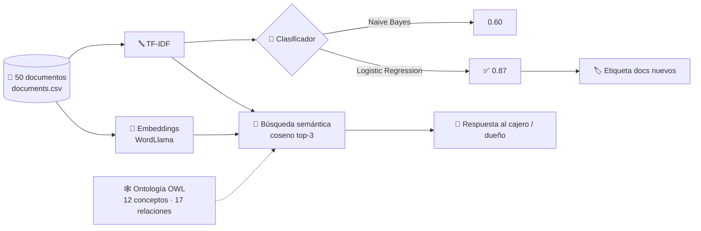

---

## ♻️ Ciclo de vida del conocimiento

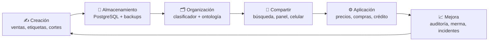

<p align="center">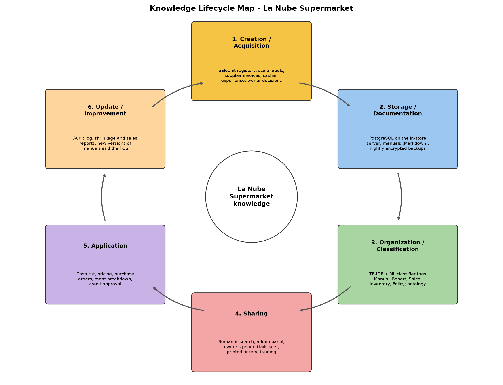</p>

---

## 🕸️ Ontología

`diagrams/la-nube-ontology.ttl` (OWL, 96 triples) — ábrela en **Protégé**.

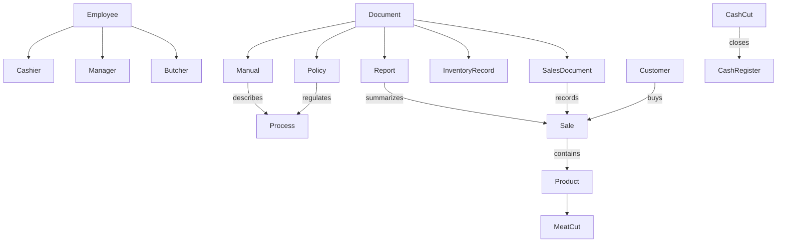

<p align="center">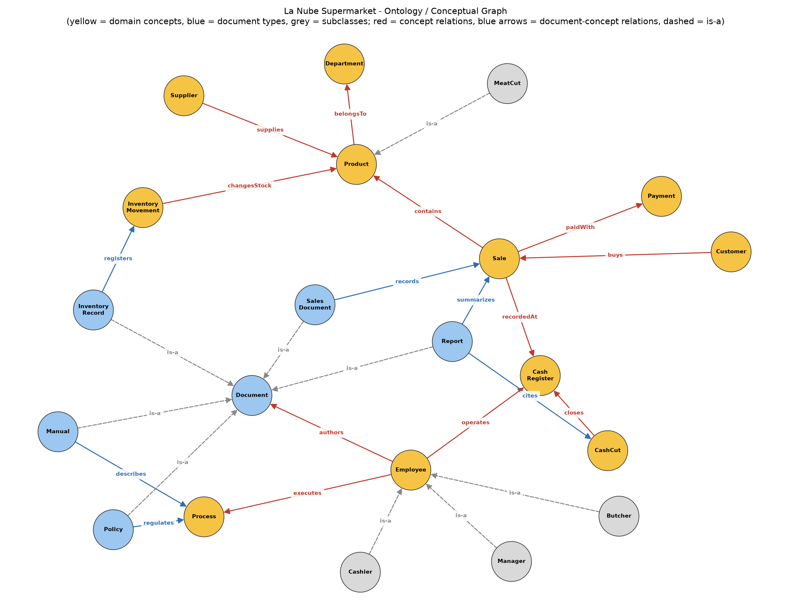</p>

---

## 📊 Resultados

### 🤖 Clasificación

| Modelo | Hold-out (15 docs) | 5-fold CV | Docs nuevos |
|---|:-:|:-:|:-:|
| Naive Bayes | 🟠 0.60 | 0.78 ± 0.15 | — |
| **Logistic Regression** | 🟢 **0.87** | **0.86 ± 0.08** | **5/5** ✅ |

<p align="center">
  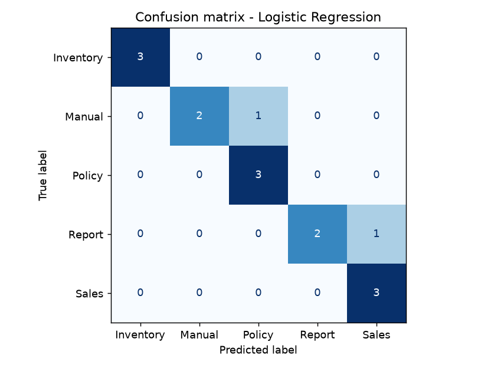
  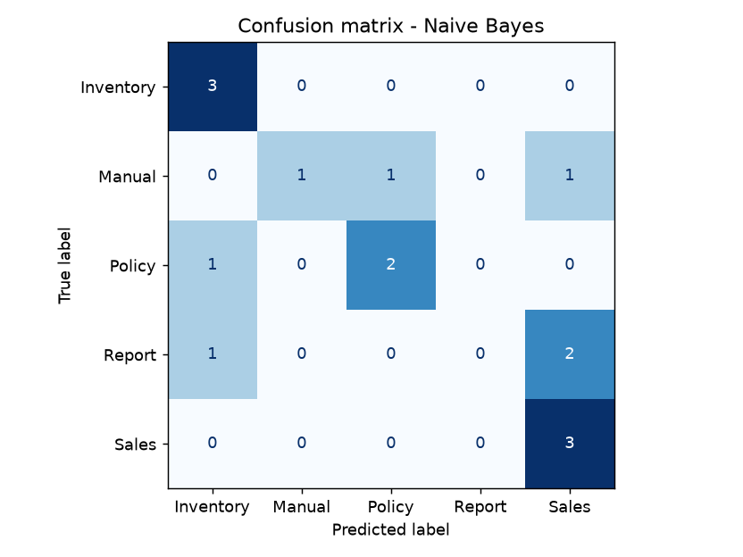
</p>

### 🔎 Búsqueda semántica

| Pregunta | 🥇 Primer resultado | Score |
|---|---|:-:|
| *how do I close the register at the end of my shift* | D04 Cashier manual – end of shift cut | 0.441 |
| *which customers owe money on credit* | D44 Customer credit policy | 0.243 |
| *meat waste and yield of beef* | D14 Shrinkage and waste report | 0.317 |
| *what happens if the internet goes down* | D50 Offline operation policy | 0.246 |
| *charge with debit card terminal* | D22 Sales ticket – card payment | 0.309 |

**Precisión@3 = 0.71 · MRR = 1.00** → el primer resultado siempre es relevante.

### 🧠 Mejora implementada: búsqueda con embeddings

TF-IDF solo encuentra documentos que **comparten palabras** con la pregunta. Si el cajero escribe *"balance the till"* en lugar de *"close the register"*, no encuentra el manual del corte. Los **embeddings** representan el significado: palabras distintas con sentido parecido quedan cerca.

`prototype/embedding_search.py` usa **WordLlama** (~16 MB, CPU, sin GPU y sin internet una vez instalado), así que corre en el servidor local del súper. Tiene tres motores: `tfidf`, `embeddings` y `hybrid` (promedio de ambos).

`prototype/compare_search.py` mide los tres motores con dos conjuntos de preguntas juzgadas:

| Conjunto | TF-IDF (antes) | Embeddings | Híbrido |
|---|:-:|:-:|:-:|
| A. Palabras clave (8 preguntas) | P@3 0.71 · MRR 1.00 | P@3 0.75 · MRR 1.00 | **P@3 0.79** · MRR 1.00 |
| B. Parafraseo cotidiano (12 preguntas) | P@3 0.14 · MRR 0.29 | **P@3 0.42 · MRR 0.69** | P@3 0.36 · MRR 0.60 |

➡️ Cuando la gente pregunta **como habla**, el primer resultado relevante sube de **MRR 0.29 a 0.69** (×2.4) y la precisión de los 3 primeros **se triplica**, sin perder nada en las preguntas con palabras clave.

<p align="center">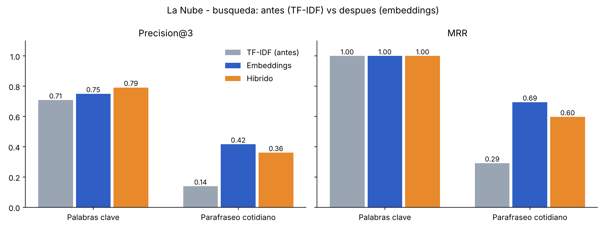</p>

Detalle por pregunta: `outputs/search_comparison.txt`. Aún falla en casos como *"balance the till"* y *"which items are running out"*: lo atacan el corpus en español y la expansión con la ontología.

<details>
<summary>📸 Capturas de consola</summary>

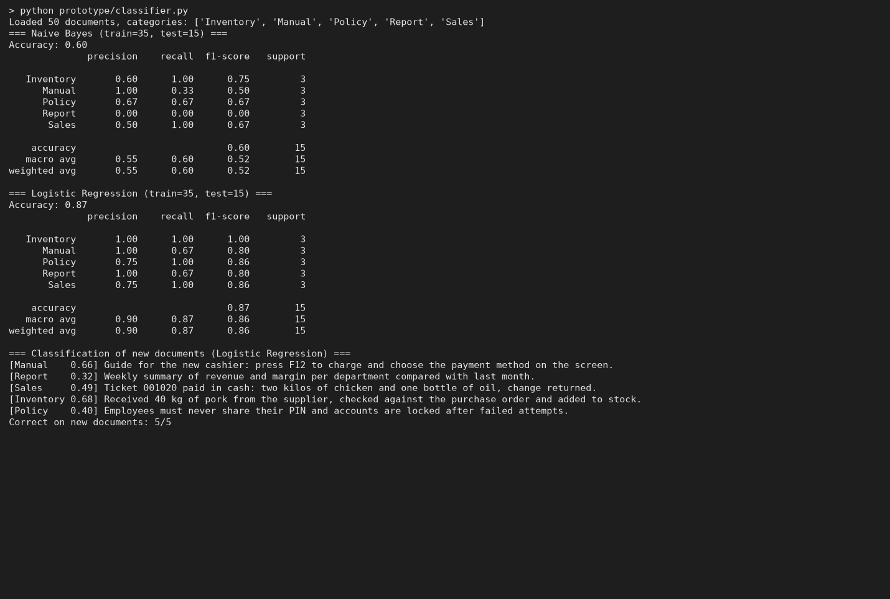
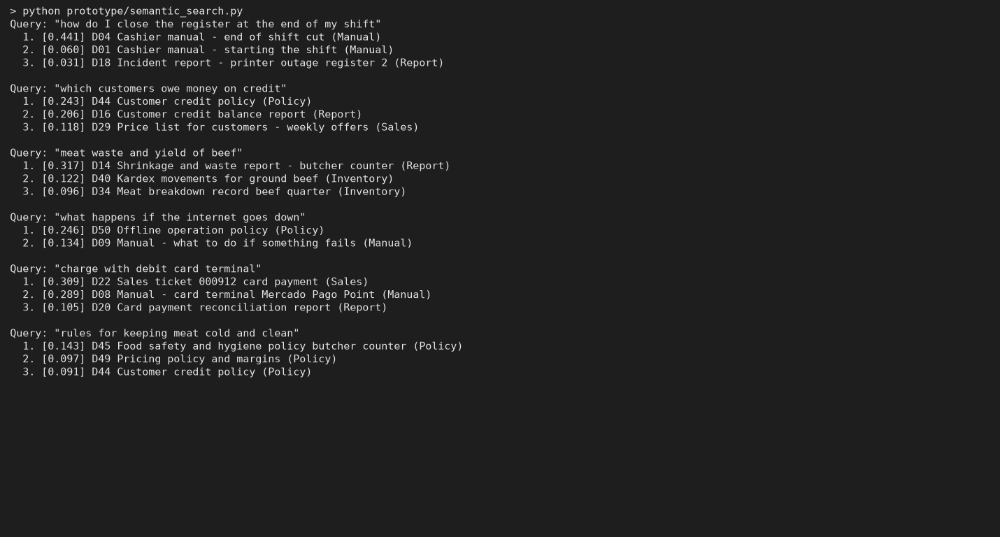
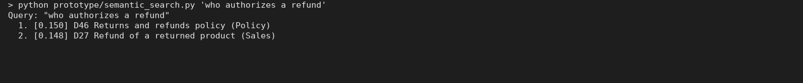
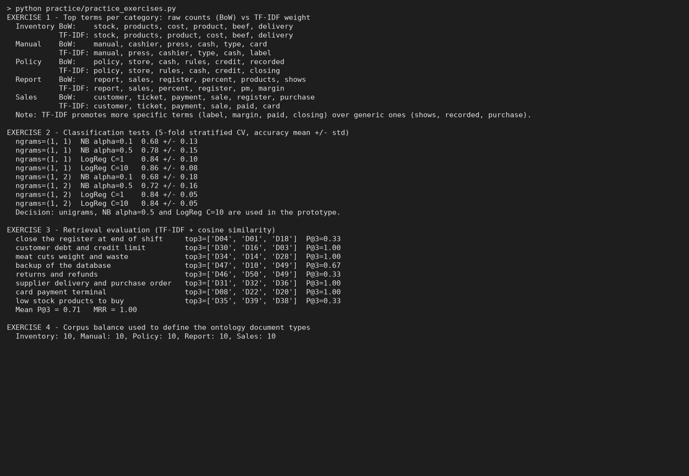

</details>

---

## 🚀 Lo que vamos a hacer (roadmap)

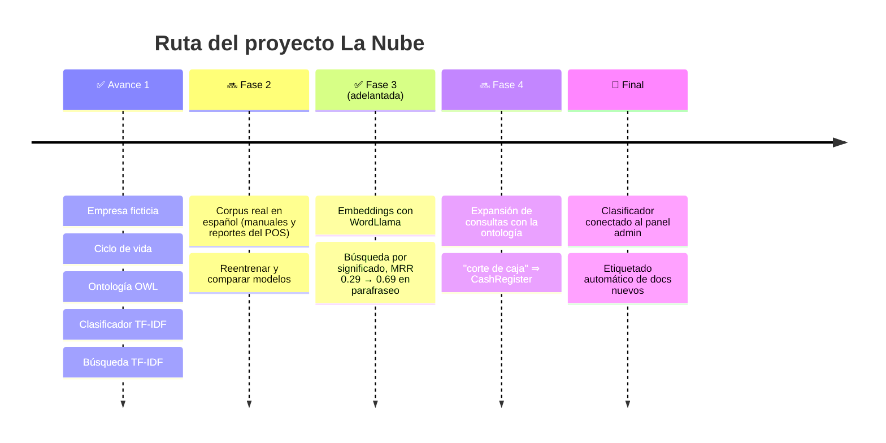

- [x] 🏪 Describir la empresa ficticia
- [x] ♻️ Mapa del ciclo de vida del conocimiento
- [x] 🕸️ Ontología / grafo conceptual
- [x] 🤖 Prototipo de clasificación (Naive Bayes vs LogReg)
- [x] 🔎 Búsqueda semántica básica (TF-IDF + coseno)
- [x] 📝 Documento de avance + evidencias
- [ ] 🇲🇽 Crecer el corpus con documentos reales del POS en español
- [x] 🧠 Búsqueda con embeddings (WordLlama) + comparación contra TF-IDF
- [ ] 🔗 Expandir búsquedas usando la ontología
- [ ] 🖥️ Integrar el clasificador al panel de administración

---

## 📁 Estructura

| Punto de la actividad | Archivo |
|---|---|
| 1. Empresa ficticia | `Avance_Proyecto_La_Nube.docx` (sección 1) |
| 2. Mapa del ciclo de vida | `diagrams/lifecycle_map.png` |
| 3. Ontología / grafo | `diagrams/ontology_graph.png`, `diagrams/la-nube-ontology.ttl` |
| 4. Clasificación (TF-IDF + NB / LogReg) | `prototype/classifier.py` |
| 5. Búsqueda semántica | `prototype/semantic_search.py` |
| Mejora: búsqueda con embeddings | `prototype/embedding_search.py` |
| Comparación antes / después | `prototype/compare_search.py`, `outputs/search_comparison.txt`, `outputs/search_comparison.png` |
| 6. Documento de avance + evidencias | `Avance_Proyecto_La_Nube.docx`, `outputs/` |
| Ejercicios de práctica (Temas 1–6) | `practice/practice_exercises.py`, `outputs/practice_results.txt` |
| Corpus (50 docs, 5 categorías) | `data/documents.csv` |

## ▶️ Ejecutar

```bash
pip install scikit-learn matplotlib networkx rdflib python-docx wordllama
python make_doc.py                                              # corre todo y regenera el .docx
python prototype/semantic_search.py "who authorizes a refund"   # búsqueda libre (TF-IDF)
python prototype/embedding_search.py "who still owes us money"  # búsqueda con embeddings
python prototype/compare_search.py                              # antes vs después (tabla + gráfica)
```

> La primera vez, WordLlama descarga su tokenizer desde Hugging Face (unos KB); después funciona sin internet.
